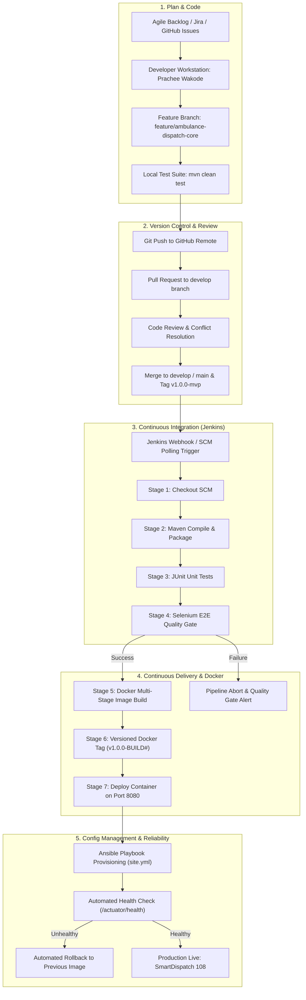

# Milestone 02: Agile Planning and DevOps Workflow

**Project Title:** SmartDispatch 108 &bull; Ambulance Dispatch Operations Dashboard  
**Candidate Name:** Prachee Wakode (23102A0020, Roll: 19)  

---

## 1. Product Backlog & User Stories

### Story US-01: Real-time Emergency Intake (Requirement 1)
- **As an** Emergency 108 Call Dispatcher,
- **I want to** quickly capture caller details, location, and triage priority,
- **So that** emergency response units can be allocated with minimal latency.
- **Acceptance Criteria:**
  1. Intake form must support Caller Name, Contact Phone, Emergency Category (Cardiac, Trauma, Accident, General), and Priority (Critical, High, Medium, Low).
  2. Input validation triggers if contact phone or location is blank.
  3. On submission, the call status transitions to `PENDING` and triggers matching available units.

### Story US-02: Searchable Fleet Dashboard (Requirement 2)
- **As a** Fleet Supervisor,
- **I want to** filter and search ambulances by vehicle registration, driver name, current hub, and status,
- **So that** I have immediate visibility over the city's active ambulance availability.
- **Acceptance Criteria:**
  1. Instant keyboard search across driver name, registration number, and hospital.
  2. Interactive status filter buttons (`ALL`, `AVAILABLE`, `DISPATCHED`, `ON_SCENE`, `AT_HOSPITAL`, `OUT_OF_SERVICE`).
  3. Dynamic grid updates without requiring a full page refresh.

### Story US-03: Summary Indicator Metrics (Requirement 3)
- **As an** Operations Commander,
- **I want to** view high-level KPIs including Total Fleet, Available Units, In-Transit Units, Active Calls, Response Time, and Utilization %,
- **So that** I can make high-level redeployment decisions during surge periods.
- **Acceptance Criteria:**
  1. Real-time metric cards refresh every 15 seconds.
  2. Average response time is calculated and formatted in minutes.
  3. Fleet utilization percentage updates dynamically as units are dispatched.

### Story US-04: Journey Drill-Down Timeline (Requirement 4)
- **As a** Paramedic Coordinator,
- **I want to** view a chronological journey drill-down for any ambulance,
- **So that** I can review each milestone (Call Received &rarr; Unit Assigned &rarr; Arrived on Scene &rarr; In-transit &rarr; ER Handover).
- **Acceptance Criteria:**
  1. Clicking "Timeline" on any unit row launches a drill-down modal.
  2. Chronological sequence of dispatch events is rendered with exact timestamps.
  3. Includes dispatcher remarks and assigned emergency call ID reference.

### Story US-05: Critical Alert & Exception Triage (Requirement 5)
- **As a** Safety & Fleet Maintenance Officer,
- **I want to** receive automatic visual alerts when oxygen levels drop below 20% or when critical calls remain unassigned,
- **So that** no ambulance is sent into the field unprepared.
- **Acceptance Criteria:**
  1. Prominent warning banner surfaces when oxygen < 20% or fuel < 15%.
  2. Unassigned Critical Priority (Code Red) calls trigger an immediate flashing exception.
  3. Operators can click "Acknowledge" to log that the issue has been triaged.

---

## 2. 15-Task Kanban / Scrum Sprint Plan

| Task ID | Task Title | Sprint | Story Points | Status | Assigned |
| :--- | :--- | :---: | :---: | :---: | :--- |
| **TSK-01** | Problem Definition, Scope & Stakeholder Freeze | Sprint 1 | 3 | **DONE** | Prachee Wakode |
| **TSK-02** | Agile Backlog, DoD & DevOps Workflow Design | Sprint 1 | 3 | **DONE** | Prachee Wakode |
| **TSK-03** | Architecture, REST API Design & Spring Boot Setup | Sprint 1 | 5 | **DONE** | Prachee Wakode |
| **TSK-04** | Git & GitHub Repo Init, Branch Policies, Skeleton | Sprint 1 | 3 | **DONE** | Prachee Wakode |
| **TSK-05** | Feature 1 Development (`feature/ambulance-dispatch-core`) | Sprint 2 | 5 | **DONE** | Prachee Wakode |
| **TSK-06** | MVP Completion, Merge Conflict Demo & Tag `v1.0.0-mvp` | Sprint 2 | 5 | **DONE** | Prachee Wakode |
| **TSK-07** | Jenkins Installation & Freestyle/CI Build Setup | Sprint 2 | 5 | **DONE** | Prachee Wakode |
| **TSK-08** | Declarative Jenkinsfile Pipeline & Tomcat Deployment | Sprint 2 | 5 | **DONE** | Prachee Wakode |
| **TSK-09** | Selenium WebDriver Test Suite Design & Execution | Sprint 3 | 5 | **DONE** | Prachee Wakode |
| **TSK-10** | Continuous Testing Gate in Jenkins & Defect Fix Patch | Sprint 3 | 5 | **DONE** | Prachee Wakode |
| **TSK-11** | Multi-Stage Dockerfile & Container Lifecycle Scripts | Sprint 3 | 5 | **DONE** | Prachee Wakode |
| **TSK-12** | Jenkins-Docker Automated CD Pipeline Setup | Sprint 3 | 5 | **DONE** | Prachee Wakode |
| **TSK-13** | Ansible Server Configuration Playbook & Inventory | Sprint 4 | 5 | **DONE** | Prachee Wakode |
| **TSK-14** | Automated Provisioning, Idempotency & Rollback Demo | Sprint 4 | 5 | **DONE** | Prachee Wakode |
| **TSK-15** | Final Documentation, Presentation Deck & Viva Defense | Sprint 4 | 3 | **DONE** | Prachee Wakode |

---

## 3. Definition of Done (DoD)

A user story or feature task is considered **DONE** only when:
1. **Clean Code & Architecture:** Clean Java code adhering to standard conventions, proper model separation, and zero compilation warnings.
2. **Automated Unit Testing:** JUnit 5 unit tests covering REST endpoints and business services with 100% pass rate.
3. **Automated Selenium UI Testing:** Headless Selenium WebDriver scripts verifying user journeys (entry, search, drilldown, alerts).
4. **Git Branching Policy Followed:** Work completed on `feature/*` branch, peer reviewed, and merged into `develop` / `main`.
5. **Continuous Integration Gate:** Jenkins pipeline completes compilation, unit testing, and artifact generation successfully without manual intervention.
6. **Containerization:** Clean Docker image build using multi-stage Dockerfile, validated via container health checks.
7. **Infrastructure as Code:** Ansible playbook executes idempotently with zero failed tasks.
8. **Documentation:** Deliverable markdown and technical architecture diagrams updated in the repository.

---

## 4. End-to-End DevOps Lifecycle Workflow

