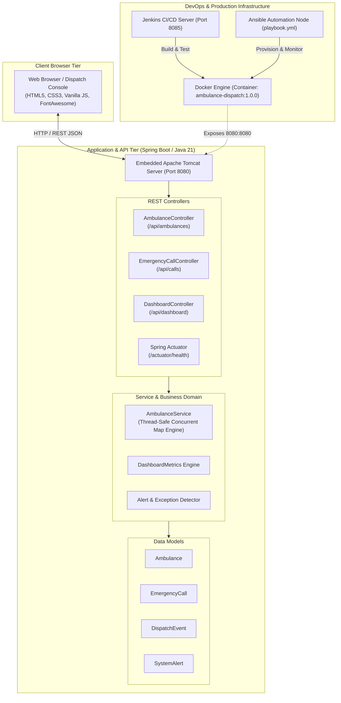
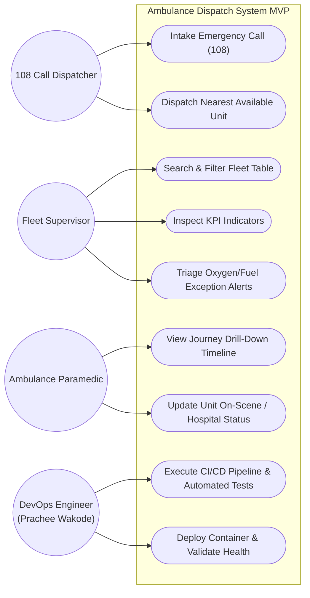

# Milestone 03: Requirements, Architecture and Technology Setup

**Project Title:** SmartDispatch 108 &bull; Ambulance Dispatch Operations Dashboard  
**Candidate Name:** Prachee Wakode (23102A0020, Roll: 19)  

---

## 1. Software Requirements Specification (SRS) Summary

### 1.1 Functional Requirements
- **FR-1: Data & Event Entry:** System shall allow immediate intake of emergency 108 calls and ambulance registrations, assigning unique IDs (`CALL-XXX`, `AMB-XXX`).
- **FR-2: Searchable Dashboard:** System shall provide a dynamic search bar and status filter buttons (`ALL`, `AVAILABLE`, `DISPATCHED`, `ON_SCENE`, `AT_HOSPITAL`, `OUT_OF_SERVICE`) filtering records in real time.
- **FR-3: Summary Indicators:** System shall calculate and display six real-time operational KPIs: Total Fleet Units, Available Units, Dispatched Units, Active Emergencies, Average Response Time, and Fleet Utilization %.
- **FR-4: Status Drill-Down:** System shall support viewing the end-to-end timeline of an ambulance from initial dispatch through scene arrival and hospital triage.
- **FR-5: Alert & Exception View:** System shall detect and present prominent alerts when oxygen levels drop below 20%, fuel drops below 15%, or when high-priority calls remain unassigned.

### 1.2 Non-Functional Requirements
- **NFR-1: Performance:** REST API endpoints must respond in < 150ms under typical dispatch center loads.
- **NFR-2: Reliability & Availability:** The application must maintain 99.9% uptime backed by Docker container restarts and health check monitors.
- **NFR-3: Portability:** The service runs as an embedded Tomcat executable JAR and multi-stage Linux Docker container (`eclipse-temurin:21-jre-alpine`).

---

## 2. Technology Stack Selection

| Layer | Selected Technology | Justification |
| :--- | :--- | :--- |
| **Language & Runtime** | Java 21 LTS | Enterprise stability, Virtual Threads support, long-term support release. |
| **Framework** | Spring Boot 3.2.5 | Embedded Tomcat, robust REST controller mapping, Actuator health metrics. |
| **Build Automation** | Apache Maven 3.9.16 | Standard declarative dependency management, surefire test reporting, Jenkins native support. |
| **Web Tier / UI** | HTML5, CSS3, Vanilla JS, FontAwesome | Fast, zero frontend build overhead, responsive split-screen layout. |
| **Testing** | JUnit 5 & Selenium WebDriver 4 | Unit verification, REST endpoint testing, automated headless browser UI journeys. |
| **Continuous Integration**| Jenkins (Pipeline as Code) | Automated commit triggers, artifact archiving, test report publishing. |
| **Containerization** | Docker & Docker Compose | Multi-stage image build, resource isolation, environment parity. |
| **Config Management** | Ansible | Declarative, agentless YAML automation for host provisioning and rollback. |

---

## 3. System Architecture Diagram



---

## 4. Use Case Diagram



---

## 5. REST API Specification

| HTTP Verb | Endpoint URI | Description | Status Code |
| :--- | :--- | :--- | :---: |
| `GET` | `/api/ambulances` | List all ambulances or filter via `?query=` & `?status=` | `200 OK` |
| `GET` | `/api/ambulances/{id}` | Retrieve individual ambulance details | `200 / 404` |
| `POST` | `/api/ambulances` | Register new ambulance vehicle to fleet | `200 OK` |
| `PATCH` | `/api/ambulances/{id}/status` | Update unit status (`AVAILABLE`, `DISPATCHED`, etc.) | `200 OK` |
| `GET` | `/api/ambulances/{id}/events` | Retrieve chronological timeline dispatch events | `200 OK` |
| `GET` | `/api/calls` | List all emergency distress calls | `200 OK` |
| `POST` | `/api/calls` | Register new emergency intake (Caller, triage, location) | `200 OK` |
| `POST` | `/api/calls/{id}/dispatch` | Dispatch specific ambulance ID to an emergency call | `200 OK` |
| `GET` | `/api/dashboard/metrics` | Retrieve real-time summary indicators (KPIs) | `200 OK` |
| `GET` | `/api/dashboard/alerts` | Retrieve active exceptions (Low oxygen, fuel, delays) | `200 OK` |
| `POST` | `/api/dashboard/alerts/{id}/resolve`| Mark system alert as acknowledged/resolved | `200 OK` |
| `GET` | `/actuator/health` | Spring Boot Actuator automated health check endpoint | `200 OK` |

---

## 6. Data Model Entity Definitions

```
+-------------------------------------------------------+
|                      Ambulance                        |
+-------------------------------------------------------+
| - id: String (e.g. "AMB-101")                         |
| - vehicleNumber: String (e.g. "MH-12-RN-1010")        |
| - driverName: String                                  |
| - driverPhone: String                                 |
| - status: String (AVAILABLE, DISPATCHED, ON_SCENE...) |
| - currentLocation: String                             |
| - assignedHospital: String                            |
| - oxygenPercent: int (0 - 100)                        |
| - fuelPercent: int (0 - 100)                          |
| - currentCallId: String                               |
| - lastUpdated: LocalDateTime                          |
+-------------------------------------------------------+
                           |
                           | 1:N
                           v
+-------------------------------------------------------+
|                    DispatchEvent                      |
+-------------------------------------------------------+
| - id: String (e.g. "EVT-1001")                        |
| - ambulanceId: String                                 |
| - callId: String                                      |
| - eventType: String                                   |
| - remarks: String                                     |
| - timestamp: LocalDateTime                            |
+-------------------------------------------------------+

+-------------------------------------------------------+
|                    EmergencyCall                      |
+-------------------------------------------------------+
| - id: String (e.g. "CALL-101")                        |
| - callerName: String                                  |
| - callerPhone: String                                 |
| - locationAddress: String                             |
| - emergencyType: String (Cardiac, Trauma, Accident...)|
| - priority: String (CRITICAL, HIGH, MEDIUM, LOW)      |
| - assignedAmbulanceId: String                         |
| - status: String (PENDING, DISPATCHED, RESOLVED...)   |
| - notes: String                                       |
| - createdAt: LocalDateTime                            |
| - dispatchedAt: LocalDateTime                         |
| - resolvedAt: LocalDateTime                           |
+-------------------------------------------------------+

+-------------------------------------------------------+
|                     SystemAlert                       |
+-------------------------------------------------------+
| - id: String (e.g. "ALT-501")                         |
| - alertType: String (LOW_OXYGEN, LOW_FUEL...)         |
| - severity: String (CRITICAL, WARNING, INFO)          |
| - message: String                                     |
| - ambulanceId: String                                 |
| - callId: String                                      |
| - timestamp: LocalDateTime                            |
| - resolved: boolean                                   |
+-------------------------------------------------------+
```

---

## 7. Local Development Setup Guide

### Prerequisites
- JDK 21 LTS installed and configured in `JAVA_HOME`
- Apache Maven 3.9+ (or use included Maven binary)
- Git 2.40+
- Modern Web Browser (Google Chrome or Microsoft Edge)

### Execution Commands
```powershell
# 1. Clone or navigate to the repository directory
cd C:\Users\Prachee\.gemini\antigravity\scratch\ambulance-dispatch-dashboard

# 2. Run unit and integration tests
mvn clean test

# 3. Package executable Spring Boot JAR
mvn clean package -DskipTests=false

# 4. Run application locally
mvn spring-boot:run

# 5. Access the live dashboard
http://localhost:8080
```
