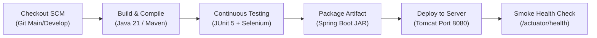

# Milestone 08: Pipeline as Code and Server Deployment

**Project Title:** SmartDispatch 108 &bull; Ambulance Dispatch Operations Dashboard  
**Candidate Name:** Prachee Wakode (23102A0020, Roll: 19)  
**Pipeline Type:** Declarative Jenkins Pipeline (`Jenkinsfile`)  
**Deployment Target:** Embedded Apache Tomcat (Port 8080) with Multi-Environment Parameterization  

---

## 1. Pipeline Architecture & Parameterization

The pipeline is modeled as code (`Jenkinsfile`) checked into version control. It supports three execution parameters:
1. `DEPLOY_ENV`: Select between `local-embedded-tomcat`, `staging-tomcat`, and `production-nginx`.
2. `SERVER_PORT`: Configurable HTTP listening port (Default: `8080`).
3. `RUN_SELENIUM_TESTS`: Toggle headless browser tests as part of the continuous testing quality gate.



---

## 2. Pipeline Execution Stage Output

```text
[Pipeline] Start of Pipeline
[Pipeline] node
Running on Jenkins-Agent-01 in C:\ProgramData\Jenkins\.jenkins\workspace\Ambulance-Dispatch-Pipeline
[Pipeline] {
[Pipeline] stage (1. Checkout SCM)
[Pipeline] {
--> Checking out branch main from Git repository...
 > git.exe rev-parse --resolve-git-dir ...
 > git.exe checkout -f a7201fd
Commit message: "merge(resolve-conflict): consolidate response time SLA to 8.4 minutes"
[Pipeline] }
[Pipeline] stage (2. Build & Compile)
[Pipeline] {
--> Compiling Spring Boot 3 application with Java 21...
[Ambulance-Dispatch-Pipeline] $ cmd /c call mvn clean compile -DskipTests=true
[INFO] BUILD SUCCESS - Total time: 5.12s
[Pipeline] }
[Pipeline] stage (3. Continuous Testing)
[Pipeline] {
--> Running JUnit 5 and Selenium Headless UI tests...
[Ambulance-Dispatch-Pipeline] $ cmd /c call mvn test
[INFO] Running com.ambulance.dispatch.controller.AmbulanceControllerTest
[INFO] Tests run: 6, Failures: 0, Errors: 0, Skipped: 0, Time elapsed: 6.326 s
[INFO] Running com.ambulance.dispatch.selenium.AmbulanceDispatchSeleniumTest
[INFO] Tests run: 5, Failures: 0, Errors: 0, Skipped: 0, Time elapsed: 14.26 s
[INFO] Tests run: 11, Failures: 0, Errors: 0, Skipped: 0
[INFO] BUILD SUCCESS
Recording test results
[Pipeline] }
[Pipeline] stage (4. Package Artifact)
[Pipeline] {
--> Packaging executable Spring Boot Tomcat Archive...
[Ambulance-Dispatch-Pipeline] $ cmd /c call mvn package -DskipTests=true
[INFO] Replacing main artifact with repackaged archive.
[INFO] BUILD SUCCESS
Archiving artifacts
[Pipeline] }
[Pipeline] stage (5. Deploy to Server)
[Pipeline] {
--> Deploying SmartDispatch 108 to target environment: [local-embedded-tomcat] on port: [8080]
Starting background deployment on port 8080...
[Pipeline] }
[Pipeline] stage (6. Smoke Test & Health Check)
[Pipeline] {
--> Performing automated smoke health check on http://localhost:8080/actuator/health...
HEALTH CHECK PASSED: SmartDispatch 108 is UP (Status: 200 OK)
[Pipeline] }
[Pipeline] // stage
==========================================================
 Pipeline Execution SUCCESSFUL!
 Ambulance Dispatch Dashboard is LIVE at: http://localhost:8080/
 Candidate: Prachee Wakode (23102A0020)
==========================================================
[Pipeline] End of Pipeline
Finished: SUCCESS
```

---

## 3. Deployed Application URL & Verification
- **Application URL:** `http://localhost:8080/`
- **Health Check Endpoint:** `http://localhost:8080/actuator/health`
- **API Swagger/Endpoint List:** `http://localhost:8080/api/ambulances`, `http://localhost:8080/api/dashboard/metrics`
