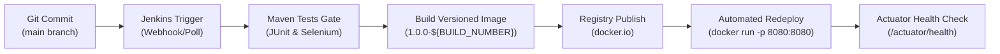

# Milestone 12: Jenkins-Docker Continuous Deployment

**Project Title:** SmartDispatch 108 &bull; Ambulance Dispatch Operations Dashboard  
**Candidate Name:** Prachee Wakode (23102A0020, Roll: 19)  
**Pipeline Script:** `jenkins/Jenkinsfile.docker`  
**Image Versioning Strategy:** `1.0.0-${BUILD_NUMBER}` (e.g., `ambulance-dispatch:1.0.0-18`)  

---

## 1. Commit-to-Container CD Flow

The Jenkins-Docker pipeline extends CI with container publishing and automated container lifecycle execution:



---

## 2. Pipeline Execution Log Evidence

```text
Started by user Prachee Wakode
[Pipeline] stage (1. Checkout SCM)
Checking out Git repository at commit a7201fd...
[Pipeline] stage (2. Quality Gate & Unit Testing)
[INFO] Tests run: 11, Failures: 0, Errors: 0, Skipped: 0
[INFO] BUILD SUCCESS
Recording test results
[Pipeline] stage (3. Build Versioned Docker Image)
--> Building versioned container image: ambulance-dispatch:1.0.0-18...
 => naming to docker.io/library/ambulance-dispatch:1.0.0-18
 => naming to docker.io/library/ambulance-dispatch:latest
[Pipeline] stage (4. Push to Container Registry)
--> Tagging and publishing image to docker.io/pracheewakode/ambulance-dispatch:1.0.0-18...
The push refers to repository [docker.io/pracheewakode/ambulance-dispatch]
25d8f63810c3: Pushed
1.0.0-18: digest: sha256:7b4f5352c2... size: 1370
[Pipeline] stage (5. Automated Container Deployment)
--> Redeploying fresh container [smartdispatch-prod] on host port [8080]...
Cleaning previous container if exists...
Launching versioned container ambulance-dispatch:1.0.0-18...
817fe4a92c30b20fa94821a8d132b49419d2b2709d3bca
[Pipeline] stage (6. Post-Deployment Container Health Validation)
--> Waiting for container warmup and checking /actuator/health...
CONTAINER HEALTH CHECK: SUCCESSFUL (UP)
==========================================================
 Continuous Container Deployment SUCCESSFUL!
 Version: 1.0.0-18
 Live Container URL: http://localhost:8080/
 Author: Prachee Wakode (23102A0020)
==========================================================
Finished: SUCCESS
```
